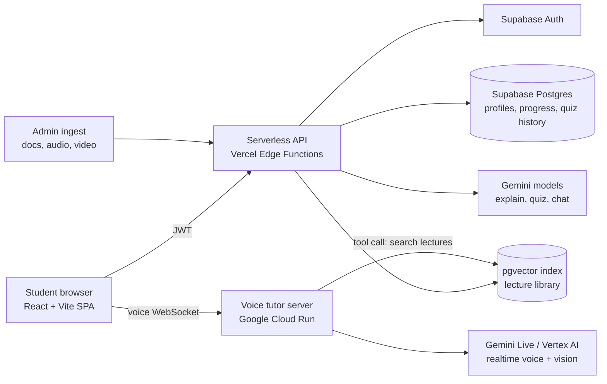

# StudyOS by LostMind AI

**An explain-then-quiz study assistant with a live voice tutor.**

StudyOS helps university students prepare for quizzes and exams. It explains each topic first, then tests understanding, tracks weak spots, and lets students talk a topic through with a voice tutor that's grounded in their own course material.

**Status:** live private pilot on university nursing coursework (not publicly listed) · **Company:** [www.lostmindai.com](https://www.lostmindai.com)

> This is a public showcase. The product source is private. Demo on request via [www.lostmindai.com](https://www.lostmindai.com).

## The problem it solves

Students drown in lecture slides, recordings and readings, and generic AI chat answers from the open internet rather than from *their* course. StudyOS grounds every explanation, quiz and tutor answer in the actual lecture content for the unit, and turns study time into a loop: **learn, quiz, review, repeat**, guided by what the student is getting wrong.

## Key features

1. **Pick a subject and topic.** Units and weekly topics follow the course timetable.
2. **Learn.** AI-written concept explanations with practical, clinical relevance, grounded in lecture content.
3. **Quiz.** Practice or test mode with generated multiple-choice questions, each tagged to a concept.
4. **Review.** Per-concept accuracy breakdown from quiz history.
5. **Ask and attach.** Upload PDFs, Word, PowerPoint or images and chat about them, with server-side retrieval over the course's lecture library.
6. **Voice tutor.** A live voice conversation with camera or screen share, which can look up lecture content mid-conversation.
7. **Progress and study plan.** Scores per subject, topic heatmaps, weak-topic detection, and assessment-aware daily recommendations (weak first, then review, then new).
8. **Content pipeline.** Admin tools ingest lecture documents, recordings and videos into the searchable library.

## Architecture

- Retrieval runs server-side, so the lecture library never ships to the browser.
- Row-level security in Postgres keeps each student's progress private.
- The voice tutor uses tool calls to search lecture content instead of guessing.

## Stack

| Layer | Technology |
|---|---|
| Frontend | React 19, TypeScript, Vite, React Router, Tailwind CSS, shadcn/ui, Motion |
| API | Vercel Edge Functions |
| Data and auth | Supabase (Postgres, Auth with Google OAuth and email, row-level security) |
| Retrieval | Gemini embeddings + pgvector (HNSW index) |
| Models | Google Gemini (explanations, quizzes, chat), Gemini Live via Vertex AI (voice) |
| Voice | WebSocket server on Google Cloud Run |
| Testing | Vitest |

## Where it's going

The same voice-tutor core is being generalised into a multi-tenant voice-agent platform at LostMind AI, so other courses and organisations can run grounded voice assistants on their own content.

## About

Built by [LostMind AI](https://www.lostmindai.com), Sydney, Australia.

Source is private. To see a demo or discuss a pilot for your course, get in touch via [www.lostmindai.com](https://www.lostmindai.com).

© 2026 LostMind AI Pty Ltd. This repository contains documentation only. See [LICENSE](LICENSE).
